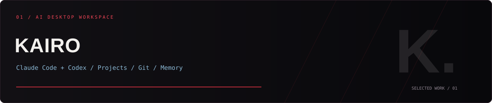
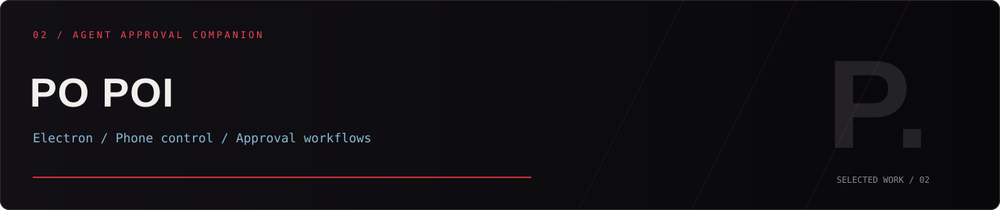
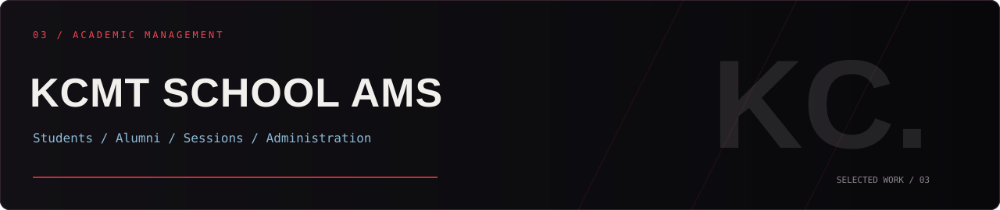
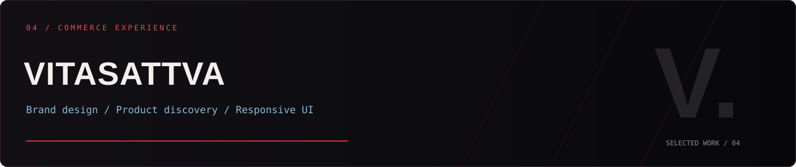
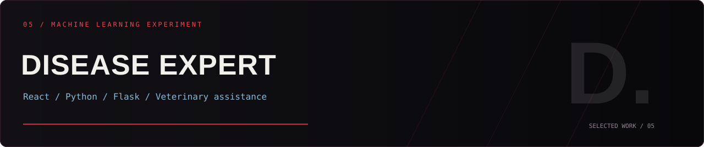
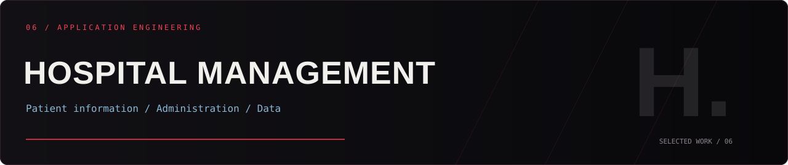

<!-- THE WOLF CODEX / GitHub profile for im-divxnshh
Upload README.md, README-STATIC.md, and assets/ together to the repository root.
SVG illustrations adapt to reduced-motion preferences; the static README is a manual alternative.
Additional project descriptions, technologies, and contact links were supplied in the HTML brief.
No employment history, usage figures, certifications, or release status has been invented.
-->

<picture>
  <source media="(prefers-reduced-motion: reduce)" srcset="./assets/wolf-codex/hero-static.svg" />
  
</picture>

# The Wolf Codex

**Divyansh Chauhan · Sahil Chauhan · @im-divxnshh**

I engineer digital experiences, build intelligent applications,
and turn complex ideas into products.

**AI · Full-stack engineering · Desktop apps · Automation · Web3**

  
  
  
  
  

**[Identity](#01--identity) · [Projects](#02--selected-work) · [Stack](#03--the-arsenal) · [GitHub](#07--github-activity) · [Contact](#16--lets-build)**

[Return to the animated profile](./README.md)

<picture>
  <source media="(prefers-reduced-motion: reduce)" srcset="./assets/wolf-codex/ticker-static.svg" />
  
</picture>

## 01 / Identity

**Technology is the medium. Problem-solving is the objective.**

I'm **Divyansh Chauhan**, also known as **Sahil Chauhan**, a full-stack web and
application developer from **Uttar Pradesh, India**.

My work spans modern web experiences, desktop software, backend systems,
and intelligent developer tools. I care about clear architecture and useful products.

| Developer record | Details |
| :--- | :--- |
| **Role** | Full-stack web & application developer |
| **Location** | Uttar Pradesh, India |
| **BCA** | Completed in 2025 |
| **MCA** | Currently pursuing · expected around 2027 |
| **Focus** | AI, Web3, automation, and desktop applications |
| **GitHub** | [@im-divxnshh](https://github.com/im-divxnshh) |

<strong>Open the developer terminal</strong>

 
<picture>
  <source media="(prefers-reduced-motion: reduce)" srcset="./assets/wolf-codex/terminal-static.svg" />
  
</picture>

**My loop:** understand → build → validate → ship → improve.

---

## 02 / Selected work

**Built in the dark. Designed to be useful.**

Products, experiments, and engineering projects across AI, education, commerce,
and application development.

### 01 · Kairo

<picture>
  <source media="(prefers-reduced-motion: reduce)" srcset="./assets/wolf-codex/project-kairo-static.svg" />
  
</picture>

**An AI desktop workspace for a developer’s everyday workflow.**

Kairo combines Claude Code and Codex providers with projects, Git, memory, and prompt management.

**Stack:** Electron · JavaScript · AI agents · Git

**[Browse repositories ↗](https://github.com/im-divxnshh?tab=repositories)**

Inside Kairo

 

| Area | What it does |
| :--- | :--- |
| **Provider integrations** | Claude Code and Codex in one workspace. |
| **Projects** | Organize work around its project context. |
| **Git** | Keep version-control context close to the conversation. |
| **Memory** | Manage context for ongoing development. |
| **Prompt management** | Keep useful instructions organized and reusable. |

### 02 · Po Poi

<picture>
  <source media="(prefers-reduced-motion: reduce)" srcset="./assets/wolf-codex/project-po-poi-static.svg" />
  
</picture>

**An Electron companion for AI coding agent approvals.**

Po Poi helps approve agent actions and supports phone control through Telegram and WhatsApp.

**Stack:** Electron · Node.js · Telegram · WhatsApp · Automation

**[Browse repositories ↗](https://github.com/im-divxnshh?tab=repositories)**

Inside Po Poi

 

| Area | What it does |
| :--- | :--- |
| **Agent approvals** | A focused workflow for reviewing coding-agent actions. |
| **Desktop companion** | An Electron helper alongside the development environment. |
| **Phone control** | Telegram and WhatsApp integrations for action approvals. |

<strong>Explore four more projects — education, commerce, ML & healthcare</strong>

 

### 03 · KCMT School AMS

**Academic information with a structured administrative workflow.**

Alumni and student management with academic sessions, department structures, bulk Excel uploads, and administration.

**Stack:** React · Firebase · Firestore · Electron

**[View repository ↗](https://github.com/im-divxnshh/Kcmt_School)**

Inside KCMT School AMS

 

| Area | What it does |
| :--- | :--- |
| **Records** | Student and alumni information. |
| **Academic structure** | Sessions and departments. |
| **Bulk data** | Excel upload workflows. |
| **Administration** | Tools for routine management tasks. |

### 04 · VitaSattva

**A distinctive tea e-commerce experience.**

Brand design, product discovery, and responsive shopping interfaces come together in a modern storefront.

**Stack:** Next.js · TypeScript · Tailwind CSS · Firebase

**[Browse repositories ↗](https://github.com/im-divxnshh?tab=repositories)**

### 05 · Disease Expert

**A veterinary disease assistance experiment.**

A React interface connected to Python and Flask-based machine learning workflows.

**Stack:** React · Python · Flask · Machine learning

**[Browse repositories ↗](https://github.com/im-divxnshh?tab=repositories)**

### 06 · Hospital Management

**A structured healthcare application concept.**

An application concept focused on patient information, administrative operations, and data management.

**Stack:** Next.js · React · Firebase · TypeScript

**[Browse repositories ↗](https://github.com/im-divxnshh?tab=repositories)**

**[Explore all repositories ↗](https://github.com/im-divxnshh?tab=repositories)**

---

## 03 / The arsenal

**Tools selected around the problem, the product, and the workflow.**

### Languages & frontend
<picture>
  <source media="(prefers-color-scheme: dark)" srcset="https://skillicons.dev/icons?i=js%2Cts%2Cpython%2Cjava%2Creact%2Cnextjs%2Ctailwind&amp;perline=7&amp;theme=dark" />
  <source media="(prefers-color-scheme: light)" srcset="https://skillicons.dev/icons?i=js%2Cts%2Cpython%2Cjava%2Creact%2Cnextjs%2Ctailwind&amp;perline=7&amp;theme=light" />
  
</picture>

**JavaScript · TypeScript · Python · Java · React · Next.js · Tailwind CSS**

### Backend & data
<picture>
  <source media="(prefers-color-scheme: dark)" srcset="https://skillicons.dev/icons?i=nodejs%2Cexpress%2Cflask%2Cfirebase%2Csupabase%2Cpostgres%2Cmysql%2Credis&amp;perline=4&amp;theme=dark" />
  <source media="(prefers-color-scheme: light)" srcset="https://skillicons.dev/icons?i=nodejs%2Cexpress%2Cflask%2Cfirebase%2Csupabase%2Cpostgres%2Cmysql%2Credis&amp;perline=4&amp;theme=light" />
  
</picture>

**Node.js · Express · Flask · Firebase · Supabase · PostgreSQL · MySQL · Redis**

<strong>Desktop, infrastructure & developer tools</strong>

 

<picture>
  <source media="(prefers-color-scheme: dark)" srcset="https://skillicons.dev/icons?i=electron%2Cgit%2Cgithub%2Clinux%2Cvercel%2Ccloudflare%2Cnginx%2Cdocker%2Cpostman&amp;perline=5&amp;theme=dark" />
  <source media="(prefers-color-scheme: light)" srcset="https://skillicons.dev/icons?i=electron%2Cgit%2Cgithub%2Clinux%2Cvercel%2Ccloudflare%2Cnginx%2Cdocker%2Cpostman&amp;perline=5&amp;theme=light" />
  
</picture>

**Electron · Git · GitHub · Linux · Vercel · Cloudflare · Nginx · Docker · Postman**

| Context | Tools in the toolkit |
| :--- | :--- |
| Desktop applications | Electron and Node.js |
| Version control | Git and GitHub |
| Infrastructure | Linux, Docker, Nginx, Cloudflare |
| Hosting | Vercel and Firebase |
| Data services | Firebase, Supabase, PostgreSQL, MySQL, Redis |
| API workflows | Postman |

---

## 04 / What I build

<strong>Six areas across the product lifecycle</strong>

 

| Discipline | What I build |
| :--- | :--- |
| **01 · Digital experiences** | Responsive applications, interactive interfaces, and frontend architecture. |
| **02 · Application systems** | APIs, authentication, database integration, and structured backend logic. |
| **03 · Intelligent tools** | LLM integrations, coding-agent workflows, prompts, and memory. |
| **04 · Desktop software** | Electron experiences, operating-system integrations, and background workflows. |
| **05 · Workflow engineering** | Automation, task integrations, and developer productivity tools. |
| **06 · Deployment systems** | Hosting, CI/CD, cloud services, and application delivery. |

---

## 05 / Current focus

| Exploring | The questions that interest me |
| :--- | :--- |
| **AI agents & LLMs** | How can provider integrations and context make coding workflows more useful? |
| **Developer productivity** | Which repetitive steps can tools make easier to manage? |
| **Web3 & blockchain** | Where do decentralized systems offer practical value? |
| **System architecture** | How can applications stay understandable as they grow? |
| **Desktop engineering** | How can cross-platform tools feel at home in a development environment? |
| **Open source** | What can be shared, reused, and improved with other developers? |

---

## 06 / The journey

<strong>Education, product development & ongoing learning</strong>

 

### 2025 · Bachelor of Computer Applications

Completed BCA and continued turning programming fundamentals into practical projects.

### Present → approximately 2027 · Master of Computer Applications

Currently pursuing MCA while developing applications and exploring advanced
software engineering and emerging technologies.

### Ongoing · Product engineering

Building web and desktop experiences across education, commerce, and developer tools.

### Current focus · AI & automation

Exploring AI desktop workspaces, coding-agent integrations, and phone-controlled
approval workflows through Kairo and Po Poi.

*2027 is an expected completion date.*

---

## 07 / GitHub activity

**Code, contributions, and ongoing development.**

<picture>
  <source media="(prefers-color-scheme: dark)" srcset="https://github-readme-stats.vercel.app/api?username=im-divxnshh&amp;show_icons=true&amp;hide_border=true&amp;rank_icon=github&amp;border_radius=12&amp;bg_color=0B0B0D&amp;title_color=F04455&amp;icon_color=8BB8D5&amp;text_color=EEEEEE" />
  <source media="(prefers-color-scheme: light)" srcset="https://github-readme-stats.vercel.app/api?username=im-divxnshh&amp;show_icons=true&amp;hide_border=true&amp;rank_icon=github&amp;border_radius=12&amp;bg_color=F7F4F5&amp;title_color=B51F35&amp;icon_color=3B6987&amp;text_color=342D38" />
  
</picture>

  
<picture>
  <source media="(prefers-color-scheme: dark)" srcset="https://streak-stats.demolab.com?user=im-divxnshh&amp;hide_border=true&amp;border_radius=12&amp;theme=dark&amp;background=0B0B0D&amp;ring=C42D3C&amp;fire=F04455&amp;currStreakNum=F2F0ED&amp;sideNums=EEEEEE&amp;currStreakLabel=8BB8D5&amp;sideLabels=CCCCCC&amp;dates=92929A" />
  <source media="(prefers-color-scheme: light)" srcset="https://streak-stats.demolab.com?user=im-divxnshh&amp;hide_border=true&amp;border_radius=12&amp;theme=default&amp;background=F7F4F5&amp;ring=B51F35&amp;fire=B51F35&amp;currStreakNum=342D38&amp;sideNums=342D38&amp;currStreakLabel=3B6987&amp;sideLabels=514856&amp;dates=65596A" />
  
</picture>

**[Repositories](https://github.com/im-divxnshh?tab=repositories) · [Contributions](https://github.com/im-divxnshh?tab=overview) · [Following](https://github.com/im-divxnshh?tab=following)**

<strong>Open language breakdown & contribution graph</strong>

 

<picture>
  <source media="(prefers-color-scheme: dark)" srcset="https://github-readme-stats.vercel.app/api/top-langs/?username=im-divxnshh&amp;layout=compact&amp;langs_count=8&amp;hide_border=true&amp;border_radius=12&amp;bg_color=0B0B0D&amp;title_color=F04455&amp;icon_color=8BB8D5&amp;text_color=EEEEEE" />
  <source media="(prefers-color-scheme: light)" srcset="https://github-readme-stats.vercel.app/api/top-langs/?username=im-divxnshh&amp;layout=compact&amp;langs_count=8&amp;hide_border=true&amp;border_radius=12&amp;bg_color=F7F4F5&amp;title_color=B51F35&amp;icon_color=3B6987&amp;text_color=342D38" />
  
</picture>

  
<picture>
  <source media="(prefers-color-scheme: dark)" srcset="https://github-readme-activity-graph.vercel.app/graph?username=im-divxnshh&amp;hide_border=true&amp;area=true&amp;radius=12&amp;bg_color=0B0B0D&amp;color=A8A1AE&amp;line=C42D3C&amp;point=8BB8D5&amp;area_color=C42D3C" />
  <source media="(prefers-color-scheme: light)" srcset="https://github-readme-activity-graph.vercel.app/graph?username=im-divxnshh&amp;hide_border=true&amp;area=true&amp;radius=12&amp;bg_color=F7F4F5&amp;color=514856&amp;line=B51F35&amp;point=3B6987&amp;area_color=E7AAB4" />
  
</picture>

*Repository language composition describes the code in public repositories.*

---

## 08 / Commit trail

Every useful improvement starts with a change.

**[Explore my contribution history ↗](https://github.com/im-divxnshh?tab=overview)**

<!-- Contribution snake omitted in this static version. -->

---

## 09 / Milestones

| Milestone | Where I am |
| :--- | :--- |
| **BCA** | Completed in 2025 |
| **MCA** | Pursuing · expected around 2027 |
| **AI tools** | Developing Kairo and Po Poi |
| **Application engineering** | Building across web, desktop, and data-driven workflows |

---

## 10 / Engineering philosophy
<picture>
  <source media="(prefers-reduced-motion: reduce)" srcset="./assets/wolf-codex/manifesto-static.svg" />
  
</picture>

<strong>Five principles behind the work</strong>

 

### Start with a useful outcome

Understand what someone needs to accomplish. Let that shape the feature set.

### Keep the workflow clear

Good interfaces make the next action easy to find and the current state easy to understand.

### Make control visible

AI and automation need clear review points, understandable actions, and recovery paths.

### Write for the next reader

Use focused modules, clear names, and documentation that explains important decisions.

### Finish the experience

Installation, onboarding, errors, and documentation belong to the product too.

---

## 11 / From idea to release

<strong>How I approach a new product</strong>

 

| Stage | The question to answer |
| :--- | :--- |
| **Discover** | Who needs this, and what are they trying to do? |
| **Define** | What is the smallest version that provides value? |
| **Design** | Can someone understand the workflow without a walkthrough? |
| **Build** | Are the interface, logic, and data organized clearly? |
| **Validate** | Does the important behavior work when things go wrong? |
| **Release** | Can someone install or access it and get started? |
| **Improve** | What does actual use tell us to change next? |

### Architecture questions I keep close

- What belongs in the interface, and what belongs in application logic?
- Which data needs to persist, and which state is temporary?
- How will the product explain loading, errors, and retries?
- Where should a person review an automated action?
- What will make the next feature easier to add?

---

## 12 / Learning lab

<strong>Research directions & practical experiments</strong>

 

| Area | What I want to understand better |
| :--- | :--- |
| **AI workflows** | Context, provider behavior, memory, and useful evaluations. |
| **Desktop systems** | Process boundaries, local state, and cross-platform behavior. |
| **Frontend quality** | Accessibility, responsive layouts, and performance. |
| **Backend quality** | Data modeling, clear contracts, and failure handling. |
| **Automation** | Task orchestration, approvals, and reliable recovery. |
| **Web3** | Wallet interactions and practical decentralized application models. |

**Learning approach:** build something small, inspect its behavior, and document what changed.

---

## 13 / Build notes & demos

<strong>Topics worth documenting</strong>

 

These are directions for future write-ups and demos.

- Designing an AI desktop workspace around projects, prompts, and memory.
- Keeping a person involved in coding-agent approval workflows.
- Connecting a desktop companion to phone-based controls.
- Structuring student and alumni administration around real tasks.
- Bringing a brand identity into a responsive commerce interface.
- Turning a machine learning experiment into an understandable application.

<!-- Add actual published posts or demo links here. -->
<!-- BLOG-POST-LIST:START -->
<!-- BLOG-POST-LIST:END -->

**[Follow the repositories ↗](https://github.com/im-divxnshh?tab=repositories)**

---

## 14 / Collaboration

<strong>Projects and conversations I’m interested in</strong>

 

- Useful AI and developer tools.
- Full-stack products with a clear problem to solve.
- Desktop applications and automation experiences.
- Practical open-source projects and reusable tooling.
- Thoughtful experiments in Web3 and emerging technologies.

### A good first message

Tell me the problem, who the product is for, and what you want to build.
An existing demo, repository, or short brief gives us a useful starting point.

**[Start a conversation ↗](mailto:divyansh20060@gmail.com)**

---

## 15 / Quick answers

<strong>Identity, location, education & interests</strong>

 

**What should I call you?**  
Divyansh or Sahil works.

**Where are you based?**  
Uttar Pradesh, India.

**What do you build?**  
Full-stack web and application experiences, desktop tools, and automation workflows.

**What are your current interests?**  
AI, Web3, developer productivity, and application engineering.

**What are you studying?**  
I completed BCA in 2025 and am pursuing MCA, expected around 2027.

**Where can I see your work?**  
Start with the projects above and my [GitHub repositories](https://github.com/im-divxnshh?tab=repositories).

---

## 16 / Let’s build

### A challenging idea. A useful product. A project worth engineering.

Let’s make something meaningful.

**[Start a conversation ↗](mailto:divyansh20060@gmail.com)**

**[GitHub](https://github.com/im-divxnshh) · [LinkedIn](https://www.linkedin.com/in/divaysnh-chauhan-0b9685342/) · [Instagram](https://www.instagram.com/im-divxnshh/) · [Discord](https://discord.com/users/1079830707339268327)**

Divyansh Chauhan · Full-stack web & app developer · India

  

**[Back to the top ↑](#the-wolf-codex) · [Animated profile](./README.md)**

<picture>
  <source media="(prefers-reduced-motion: reduce)" srcset="./assets/wolf-codex/footer-static.svg" />
  
</picture>
