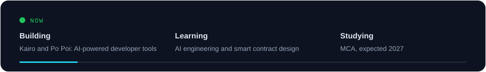
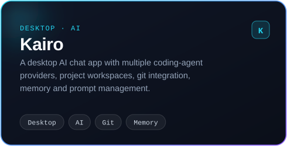
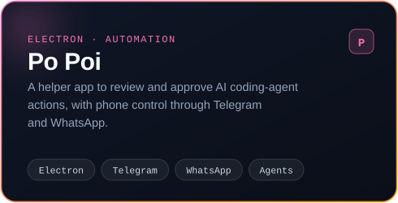

 

<table>
  <tr>
    <td></td>
    <td></td>
  </tr>
</table>

<!-- Link a card to its repo: wrap the  in <a href="https://github.com/im-divxnshh/REPO"> ... </a> -->

Have a product idea, a project to build, or an opportunity to discuss? I'd love to hear from you.

